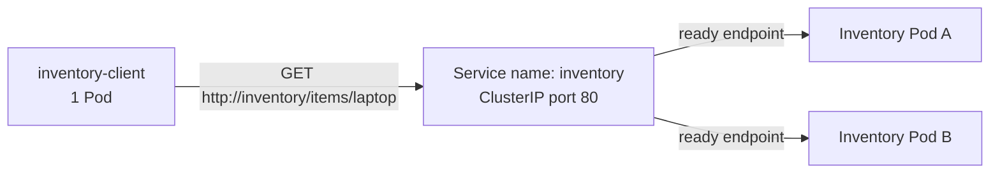

# Module 6 Assignment: Service Discovery, Readiness & Recovery

Inventory runs as two Kubernetes Pods behind one Service. A single client calls that Service by name (`http://inventory`). It never uses a Pod IP or Pod name. This was deployed on a [kind](https://kind.sigs.k8s.io/) cluster with Kubernetes 1.32.2.

## Deploy

Install Docker, kubectl, and kind. Then, from this repository:

```bash
kind create cluster --name module6 --image kindest/node:v1.32.2
docker build -t inventory-service:local .
kind load docker-image inventory-service:local --name module6
kubectl apply -f k8s/
kubectl rollout status deployment/inventory
kubectl rollout status deployment/inventory-client
```

`k8s/inventory.yaml` creates the Inventory Deployment (2 replicas) and the `inventory` Service on port 80. `k8s/client.yaml` creates one client. The client’s `INVENTORY_URL` is `http://inventory`.

The readiness probe calls `GET /ready` every 2 seconds. The liveness probe calls `GET /health`, so a Pod that fails readiness stays running. `POST /admin/readiness/fail` on a Pod makes only that Pod return 503 from `/ready`. `POST /admin/readiness/restore` makes `/ready` return 200 again.

Remove the cluster with `kind delete cluster --name module6`.

## Architecture



The Service selects Pods labeled `app=inventory`. kube-proxy sends a new client connection to one ready Pod. An unready Pod is removed from the Service endpoints even though its container is still running. Deleting a Pod does not change the Service name or the client configuration. The Deployment starts a replacement Pod, and the Service starts sending traffic to it once that Pod is ready.

## Both replicas are running

```text
NAME                                READY   STATUS    RESTARTS   AGE   IP
inventory-client-5d8db4778c-bmzjr   1/1     Running   0          12s   10.244.0.7
inventory-d4978f674-pclj5           1/1     Running   0          12s   10.244.0.2
inventory-d4978f674-q4qvj           1/1     Running   0          12s   10.244.0.5

NAME        TYPE        CLUSTER-IP     EXTERNAL-IP   PORT(S)   AGE
inventory   ClusterIP   10.96.21.175   <none>        80/TCP    12s
```

The Service endpoints were both Pod IPs:

```text
NAME        ENDPOINTS
inventory   10.244.0.2:8080,10.244.0.5:8080
```

## Evidence that both replicas receive requests

The client Pod ran a burst through the Service name, not through either Pod address:

```bash
kubectl exec deploy/inventory-client -- python /app/client.py --count 20 --interval 0.05
```

```text
client using inventory service at http://inventory
GET http://inventory/items/laptop status=200 pod=inventory-d4978f674-q4qvj available=True quantity_on_hand=5
GET http://inventory/items/laptop status=200 pod=inventory-d4978f674-pclj5 available=True quantity_on_hand=5
GET http://inventory/items/laptop status=200 pod=inventory-d4978f674-pclj5 available=True quantity_on_hand=5
GET http://inventory/items/laptop status=200 pod=inventory-d4978f674-pclj5 available=True quantity_on_hand=5
GET http://inventory/items/laptop status=200 pod=inventory-d4978f674-q4qvj available=True quantity_on_hand=5
GET http://inventory/items/laptop status=200 pod=inventory-d4978f674-pclj5 available=True quantity_on_hand=5
GET http://inventory/items/laptop status=200 pod=inventory-d4978f674-pclj5 available=True quantity_on_hand=5
GET http://inventory/items/laptop status=200 pod=inventory-d4978f674-pclj5 available=True quantity_on_hand=5
GET http://inventory/items/laptop status=200 pod=inventory-d4978f674-q4qvj available=True quantity_on_hand=5
GET http://inventory/items/laptop status=200 pod=inventory-d4978f674-pclj5 available=True quantity_on_hand=5
GET http://inventory/items/laptop status=200 pod=inventory-d4978f674-q4qvj available=True quantity_on_hand=5
GET http://inventory/items/laptop status=200 pod=inventory-d4978f674-q4qvj available=True quantity_on_hand=5
GET http://inventory/items/laptop status=200 pod=inventory-d4978f674-q4qvj available=True quantity_on_hand=5
GET http://inventory/items/laptop status=200 pod=inventory-d4978f674-q4qvj available=True quantity_on_hand=5
GET http://inventory/items/laptop status=200 pod=inventory-d4978f674-q4qvj available=True quantity_on_hand=5
GET http://inventory/items/laptop status=200 pod=inventory-d4978f674-q4qvj available=True quantity_on_hand=5
GET http://inventory/items/laptop status=200 pod=inventory-d4978f674-pclj5 available=True quantity_on_hand=5
GET http://inventory/items/laptop status=200 pod=inventory-d4978f674-q4qvj available=True quantity_on_hand=5
GET http://inventory/items/laptop status=200 pod=inventory-d4978f674-q4qvj available=True quantity_on_hand=5
GET http://inventory/items/laptop status=200 pod=inventory-d4978f674-q4qvj available=True quantity_on_hand=5
```

Every URL is `http://inventory/items/laptop`. The `pod` field shows which replica answered. Both `inventory-d4978f674-pclj5` and `inventory-d4978f674-q4qvj` received requests.

## Evidence of readiness failure and recovery

Fail readiness on one Pod:

```bash
kubectl exec inventory-d4978f674-q4qvj -- python -c "import urllib.request; urllib.request.urlopen(urllib.request.Request('http://127.0.0.1:8080/admin/readiness/fail', data=b'', method='POST'))"
```

That Pod stayed `Running`. Its ready count dropped from `1/1` to `0/1`, and the Service dropped its IP from the endpoints:

```text
NAME                        READY   STATUS    RESTARTS
inventory-d4978f674-pclj5   1/1     Running   0
inventory-d4978f674-q4qvj   0/1     Running   0

NAME        ENDPOINTS
inventory   10.244.0.2:8080
```

The next client burst reached only the ready Pod:

```text
client using inventory service at http://inventory
GET http://inventory/items/laptop status=200 pod=inventory-d4978f674-pclj5 available=True quantity_on_hand=5
GET http://inventory/items/laptop status=200 pod=inventory-d4978f674-pclj5 available=True quantity_on_hand=5
GET http://inventory/items/laptop status=200 pod=inventory-d4978f674-pclj5 available=True quantity_on_hand=5
GET http://inventory/items/laptop status=200 pod=inventory-d4978f674-pclj5 available=True quantity_on_hand=5
GET http://inventory/items/laptop status=200 pod=inventory-d4978f674-pclj5 available=True quantity_on_hand=5
GET http://inventory/items/laptop status=200 pod=inventory-d4978f674-pclj5 available=True quantity_on_hand=5
GET http://inventory/items/laptop status=200 pod=inventory-d4978f674-pclj5 available=True quantity_on_hand=5
GET http://inventory/items/laptop status=200 pod=inventory-d4978f674-pclj5 available=True quantity_on_hand=5
GET http://inventory/items/laptop status=200 pod=inventory-d4978f674-pclj5 available=True quantity_on_hand=5
GET http://inventory/items/laptop status=200 pod=inventory-d4978f674-pclj5 available=True quantity_on_hand=5
GET http://inventory/items/laptop status=200 pod=inventory-d4978f674-pclj5 available=True quantity_on_hand=5
GET http://inventory/items/laptop status=200 pod=inventory-d4978f674-pclj5 available=True quantity_on_hand=5
```

`inventory-d4978f674-q4qvj` received none of these requests.

Restore readiness:

```bash
kubectl exec inventory-d4978f674-q4qvj -- python -c "import urllib.request; urllib.request.urlopen(urllib.request.Request('http://127.0.0.1:8080/admin/readiness/restore', data=b'', method='POST'))"
```

The Pod became `1/1 Running` again and its IP returned to the Service:

```text
NAME                        READY   STATUS    RESTARTS
inventory-d4978f674-pclj5   1/1     Running   0
inventory-d4978f674-q4qvj   1/1     Running   0

NAME        ENDPOINTS
inventory   10.244.0.2:8080,10.244.0.5:8080
```

The same client command then reached both Pods again, including the restored one:

```text
GET http://inventory/items/laptop status=200 pod=inventory-d4978f674-pclj5 available=True quantity_on_hand=5
GET http://inventory/items/laptop status=200 pod=inventory-d4978f674-q4qvj available=True quantity_on_hand=5
GET http://inventory/items/laptop status=200 pod=inventory-d4978f674-q4qvj available=True quantity_on_hand=5
GET http://inventory/items/laptop status=200 pod=inventory-d4978f674-pclj5 available=True quantity_on_hand=5
GET http://inventory/items/laptop status=200 pod=inventory-d4978f674-q4qvj available=True quantity_on_hand=5
GET http://inventory/items/laptop status=200 pod=inventory-d4978f674-pclj5 available=True quantity_on_hand=5
```

## Evidence of Pod deletion and replacement

Before the delete, the two Inventory Pods and the Service were:

```text
NAME                        UID                                    PHASE     READY
inventory-d4978f674-pclj5   a9e23ad4-557e-4c07-8eb6-7f25c5a27439   Running   true
inventory-d4978f674-q4qvj   6e12e3f6-6de7-4bee-802d-d1be61b965c1   Running   true

NAME        TYPE        CLUSTER-IP     EXTERNAL-IP   PORT(S)
inventory   ClusterIP   10.96.21.175   <none>        80/TCP
```

```bash
kubectl delete pod inventory-d4978f674-q4qvj
```

Kubernetes created a replacement with a different name and UID. `inventory-d4978f674-pclj5` was left in place. The Service name was still `inventory`, and the ClusterIP was still `10.96.21.175`. The client Pod was not restarted.

```text
NAME                        UID                                    PHASE     READY
inventory-d4978f674-pclj5   a9e23ad4-557e-4c07-8eb6-7f25c5a27439   Running   true
inventory-d4978f674-r27c6   88a55bf1-988a-4f78-bebf-6c0d2fdd25bd   Running   true

NAME        TYPE        CLUSTER-IP     EXTERNAL-IP   PORT(S)
inventory   ClusterIP   10.96.21.175   <none>        80/TCP

NAME                                READY   STATUS    RESTARTS
inventory-client-5d8db4778c-bmzjr   1/1     Running   0
```

The same client command, still using `http://inventory`, reached the surviving Pod and the new Pod:

```text
client using inventory service at http://inventory
GET http://inventory/items/laptop status=200 pod=inventory-d4978f674-r27c6 available=True quantity_on_hand=5
GET http://inventory/items/laptop status=200 pod=inventory-d4978f674-r27c6 available=True quantity_on_hand=5
GET http://inventory/items/laptop status=200 pod=inventory-d4978f674-pclj5 available=True quantity_on_hand=5
GET http://inventory/items/laptop status=200 pod=inventory-d4978f674-pclj5 available=True quantity_on_hand=5
GET http://inventory/items/laptop status=200 pod=inventory-d4978f674-pclj5 available=True quantity_on_hand=5
GET http://inventory/items/laptop status=200 pod=inventory-d4978f674-r27c6 available=True quantity_on_hand=5
GET http://inventory/items/laptop status=200 pod=inventory-d4978f674-pclj5 available=True quantity_on_hand=5
GET http://inventory/items/laptop status=200 pod=inventory-d4978f674-r27c6 available=True quantity_on_hand=5
```

## Reflection

A stable Service name is useful because Pods are replaceable and their names and IPs are not. In this lab, deleting `inventory-d4978f674-q4qvj` produced a new Pod, `inventory-d4978f674-r27c6`, with a new UID, while the client kept calling `http://inventory`. The Service name and ClusterIP stayed the same, and Kubernetes added the ready replacement to the endpoints without any client change. Readiness makes that name safer to use: the unready Pod was still running, but it was taken out of the endpoints so requests went only to the Pod that could serve them. After readiness returned, and again after the replacement Pod started, the client continued through the same Service name.
